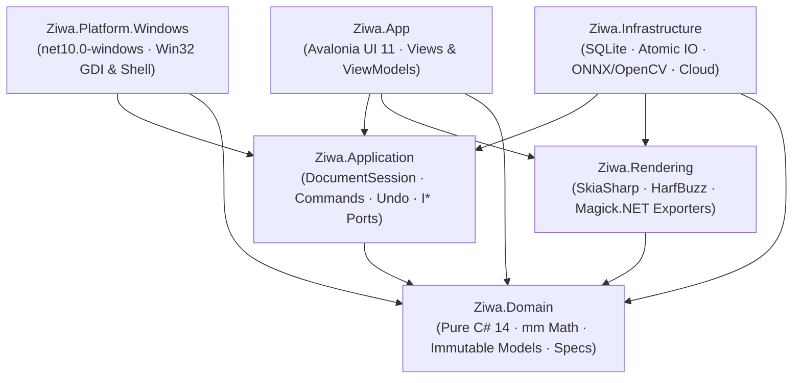
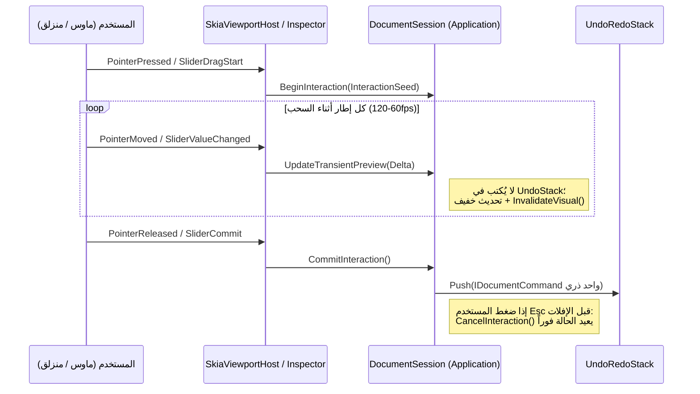

# المعمارية الهندسية الشاملة — Ziwa Studio Complete Architecture

> **الوثيقة المرجعية العليا لتصميم النظام (`System Architecture Blueprint`)**
> **المنصة:** `.NET 10 LTS` (`C# 14`) · **الواجهة:** `Avalonia UI 11` (`Fluent 2 RTL` + `CompiledBindings`) · **محرك الرسم والطباعة:** `SkiaSharp` + `HarfBuzzSharp` + `Magick.NET`

---

## 1. الرؤية والمرتكزات المعمارية الخمسة (Core Architectural Pillars)

بُنيت معمارية **Ziwa Studio** من صفحة بيضاء لتكون أداة إنتاج مكتبية احترافية لاستوديوهات التصوير والمطابع، مستخلصةً كل الدروس العملية من مشروع **Grido Studio** مع التخلص الجذري من عنق زجاجة المتصفح (`DOM / WebView / IPC Base64`):

1. **وحدة خط الرسم (`Preview == Export == Print`):**
   لا يوجد محرك عرض تفاعلي منفصل عن محرك التصدير. شجرة مشهد واحدة (`SceneGraph`) ترسم عبر `SceneRenderer` فوق أي سطح `SKCanvas` سواء أكان سطح GPU التفاعلي للشاشة (`60–120fps`)، أم سطح تصدير نقطي (`300–600 DPI`)، أم مستند `Vector PDF`، أم مسار `CMYK TIFF`، أم طابعة `Win32 GDI`.
2. **نطاق فيزيائي مليمتري نقي (`Millimeters-First Domain`):**
   المليمتر (`MmPerInch = 25.4`) هو وحدة الحقيقة الوحيدة في النطاق (`Domain`) وفي ملفات المشاريع؛ لا تُخزَّن إحداثيات بكسل شاشة أبداً داخل نموذج المستند، ولا يتحول المليمتر إلى بكسل أو نقاط طباعة إلا عند حافة الإسقاط (`ViewportTransform` أو `PrintRenderContext`).
3. **الحالة غير المتغيرة ومشاركة الهيكل (`Immutable Document + Structural Sharing`):**
   يمثَّل المستند وعناصره بسجلات غير متغيرة (`C# records` + `ImmutableArray<T>`). يوفّر هذا التصميم ثلاث مزايا حاسمة في آنٍ واحد:
   - **تراجع/إعادة فوري وخفيف الذاكرة (`O(1) Snapshot Undo/Redo`):** نسخ العقد المعدّلة فقط عبر تعبيرات `with` دون نسخ الصور الخام التي تبقى محمولة بالمرجع (`AssetId`).
   - **أمان خيطي كامل للتصدير والحفظ الخلفي (`Lock-Free Background Snapshots`):** يستطيع خيط التصدير بدقة `600 DPI` أو الحفظ التلقائي العمل على لقطة مستند ثابتة في الخلفية بينما يتابع المستخدم الرسم والتحريك في الواجهة دون أي تجميد أو أقفال (`locks`).
   - **تتبّع التغيير بتكلفة صفرية (`Reference Equality`):** يعرف الكاش ومحرك الرسم فوراً ما إذا تغيرت عقدة أم لا عبر مقارنة المرجع السريعة.
4. **عزل طبقي أحادي الاتجاه (`Zero UI / Platform Leakage`):**
   لا تعرف طبقة `Domain` أو `Rendering` أو `Application` شيئاً عن `Avalonia` أو نوافذ النظام أو `Win32 GDI`. وتُعزل شيفرة ويندوز الخاصة داخل مشروع مستقل (`Ziwa.Platform.Windows`) خلف واجهات مجردة في `Ziwa.Application` للحفاظ على قابلية الاختبار وتعدد المنصات (`Windows / macOS / Linux`).
5. **الفشل الآمن والملكية الصارمة (`Fail-Closed Safety & Operation Ownership`):**
   كل كتابة قرص تمر عبر استبدال ذري مغسول للقرص (`Flush(flushToDisk: true)`), وكل عملية غير متزامنة تحمل هوية جيل ومالك (`OperationTicket`) يمنع النتائج المتأخرة من تلويث مشروع تغيّر، وكل مدخل خارجي (ملف، حافظة، شبكة، SVG) يُفحص ويُعقّم قبل عبوره للنطاق.

---

## 2. طوبولوجيا الحل والمشاريع (`Ziwa.sln` Topology)

### 2.1 شجرة الحل المستهدفة
```text
Ziwa/
├── Directory.Build.props              # إعدادات البناء الموحدة (net10.0, C# 14, Nullable, TreatWarningsAsErrors)
├── Directory.Packages.props           # الإدارة المركزية لإصدارات الحزم (Central Package Management - CPM)
├── Ziwa.sln                           # ملف الحل الرئيسي
│
├── src/
│   ├── Ziwa.Domain/                   # [net10.0] النواة النقية: الكيانات، الرياضيات المليمترية، القوالب، التحقق
│   ├── Ziwa.Rendering/                # [net10.0] محرك SkiaSharp + HarfBuzzSharp + التصدير (PNG/JPG/PDF/CMYK)
│   ├── Ziwa.Application/              # [net10.0] حالات الاستخدام، الجلسة، الأوامر، Undo/Redo، العقود المجردة (I*)
│   ├── Ziwa.Infrastructure/           # [net10.0] الحفظ الذري، SQLite، الأصول، ONNX/OpenCV، Modal AI، Supabase، الجسر
│   ├── Ziwa.Platform.Windows/         # [net10.0-windows] طباعة Win32 GDI المباشرة، OLE Drop، Single-Instance، Win32 Chrome
│   └── Ziwa.App/                      # [net10.0] تطبيق Avalonia UI 11 (Tokens.axaml، Views، ViewModels، SkiaViewportHost)
│
├── tests/
│   ├── Ziwa.Domain.Tests/             # اختبارات الرياضيات المليمترية، الشبكات، المخططات، وقواعد النطاق
│   ├── Ziwa.Rendering.Tests/          # اختبارات التطابق البصري (Verify.Xunit) للعرض والـ 300 DPI والعربية والأقنعة
│   ├── Ziwa.Application.Tests/        # اختبارات الأوامر، Undo/Redo، سباقات العمليات، وسجل الاختصارات الموحد
│   ├── Ziwa.Infrastructure.Tests/     # اختبارات الكتابة الذرية، التعافي، SQLite، خادم الجسر، ومحاكاة السحابة
│   └── Ziwa.App.Tests/                # اختبارات الواجهة والوصولية وRTL بدون نافذة (Avalonia.Headless.XUnit)
│
├── docs/                              # الوثائق الهندسية الحية وخارطة التطوير
├── changelog/fragments/               # سجلات الجلسات الذرية (Fragment-First)
├── scripts/                           # بوابات التحقق وخطافات الأمان (docs-gate.mjs + hooks)
└── .agents/                           # دستور الوكلاء، القواعد، المهارات، ومسارات العمل
```

### 2.2 مخطط الاعتماديات الصارم (Dependency Graph)



> **قاعدة تكوين الجذر (`Composition Root`):**
> نقطة ربط `Ziwa.Infrastructure` و`Ziwa.Platform.Windows` مع `Ziwa.App` تتم حصراً عند إقلاع التطبيق (`Program.cs` / `Bootstrapper`) عبر `Microsoft.Extensions.DependencyInjection`؛ وبذلك تعمل `Ziwa.App` على أي نظام تشغيل مع تفعيل خدمات `Ziwa.Platform.Windows` شرطياً على ويندوز وتفعيل بدائل قياسية آمنة على بقية الأنظمة.

### 2.3 الحزم المعتمدة في `Directory.Packages.props`

| المجال | الحزمة المعتمدة | الدور المعماري |
|---|---|---|
| **الواجهة والـ MVVM** | `Avalonia`، `Avalonia.Desktop`، `Avalonia.Themes.Fluent`، `CommunityToolkit.Mvvm` | واجهة سطح المكتب الأصلية ومولدات الـ ViewModel بدون انعكاس (`Source Generators`) |
| **الرسم والنصوص العربية** | `Avalonia.Skia`، `SkiaSharp`، `SkiaSharp.HarfBuzz`، `HarfBuzzSharp`، `Svg.Skia` | رسم 2D موحد على GPU/CPU وتشكيل الحروف العربية ورسم SVG المتجه |
| **الطباعة اللونية `CMYK`** | `Magick.NET-Q8-AnyCPU` | تحويل فضاء الألوان `CMYK` بملفات `ICC` وتوليد `TIFF` مضغوط سليم الترويسات |
| **التخزين والبيانات** | `Microsoft.Data.Sqlite`، `System.IO.Compression` | قاعدة مشاريع محلية بوضع `WAL` وحزم مشاريع `.ziwa` الذرية |
| **الذكاء الاصطناعي المحلي** | `Microsoft.ML.OnnxRuntime`، `OpenCvSharp4` (+ runtime) | عزل الخلفية المحلي، كشف حدود المستندات، وتصحيح المنظور |
| **حقن الاعتماديات والسجلات** | `Microsoft.Extensions.DependencyInjection`، `Serilog` (`Serilog.Sinks.File`) | إدارة دورة حياة الخدمات وتسجيل مهيكل دوّار خالٍ من الأسرار |
| **الاختبارات** | `xunit`، `Verify.Xunit`، `Avalonia.Headless.XUnit` | اختبارات الوحدة، مقارنة لقطات البكسل الذهبية، واختبارات الواجهة السريعة |

---

## 3. نموذج المستند وشجرة المشهد (`Domain & Scene Graph Model`)

### 3.1 الوحدات ونظام الإحداثيات (`Ziwa.Domain.Math`)
- `MmPerInch = 25.4` هو الثابت الوحيد للتحويل في كامل الحل.
- كل صفحة (`PageModel`) تعرف أبعادها الصافية بالمليمتر (`WidthMm`, `HeightMm`)، وإعدادات النزيف (`BleedMm` في النطاق `[0 .. 25]`)، وهوامش الأمان (`SafeMarginMm`).
- إحداثيات عناصر الوضع الحر (`BoundsMm: RectMm { X, Y, Width, Height }` + `RotationDeg`) تُخزَّن **بالمليمتر نسبةً إلى ركن الورقة الصافي `(0, 0)`** (بحيث يمتد النزيف من `-BleedMm` إلى `WidthMm + BleedMm`). هذا أفضل بمراحل من الإحداثيات النسبية `[0..1]` لأنه يمنع تشوّه العناصر أو تغيّر حجم الخط عند تعديل هامش الصفحة أو طولها!

### 3.2 الهيكلة غير المتغيرة للمستند (`Immutable Records`)

```csharp
namespace Ziwa.Domain.Models;

public sealed record ZiwaDocument(
    DocumentId Id,
    int SchemaVersion,
    string Title,
    EditorWorkflow Mode,                   // Freeform | Collage
    ImmutableArray<PageModel> Pages,       // يدعم صفحة واحدة أو متعدد (وجه + ظهر)
    int ActivePageIndex,
    PrintTicketSpec PrintSettings,
    DateTimeOffset UpdatedAtUtc);

public sealed record PageModel(
    PageId Id,
    string Name,                           // مثال: "الوجه الأمامي"، "الوجه الخلفي"
    double WidthMm,
    double HeightMm,
    double BleedMm,
    double SafeMarginMm,
    BackgroundSpec Background,             // Solid | LinearGradient | RadialGradient | Transparent
    CollageLayoutModel? CollageLayout,     // نشط في وضع الكولاج
    ImmutableArray<SceneNode> Nodes);      // مرتبة حسب تسلسل الرسم (Z-Order)
```

### 3.3 أنواع عقد المشهد (`SceneNode` Hierarchy)
تشتق جميع العناصر من `abstract record SceneNode(NodeId Id, string Name, RectMm BoundsMm, double RotationDeg, double Opacity, bool IsVisible, bool IsLocked)`:
1. **`ImageNode`:**
   - `AssetId CurrentAssetId` + `AssetId OriginalAssetId` (لضمان استعادة الأصل دائماً بعد القص أو عزل الخلفية أو الترميم).
   - `CropSpec Crop` (`Zoom >= 1.0`, `PanX`, `PanY` غير هدّامة).
   - `MaskShapeKind Mask` (`None`, `Circle`, `Arch`, `Hexagon`, `Diamond`, `Heart`, `Star`, `Seal`) + `double CornerRadiusMm`.
   - `ImageFilterSpec Filters` (`Brightness`, `Contrast`, `Saturation`, `BlurPx`, `PresetId`, `Threshold`, `Pixelate`).
   - `StrokeSpec? Border` + `ShadowSpec? Shadow`.
2. **`ShapeNode`:**
   - `ShapeKind Kind` (`Rectangle`, `Ellipse`, `Triangle`, `Polygon`, `Star`, `Line`, `Arrow`, `Ring`, `Arc`, `Wedge`).
   - `ShapeFill Fill` (لون صلب، تدرج، أو **`ImageFill` يحوي `AssetId` + `CropSpec`** لدعم إفلات الصور داخل أي شكل!).
   - `CornerRadiiMm Radii` (موحدة أو مستقلة للزوايا الأربع) + `StrokeSpec Stroke` + معاملات القوس/الحلقة (`SweepAngleDeg`, `InnerRadiusRatio`).
3. **`TextNode`:**
   - `string Text`, `string FontFamily`, `double FontSizePt`, `FontWeight`, `TextAlignment`, `TextDirectionMode` (`AutoRtl`, `Rtl`, `Ltr`), `double LineHeight`, `double LetterSpacingEm`.
   - `TextCurveSpec? Curve` (قوس علوي/سفلي أو دائرة كاملة للأختام).
   - `TextEffectSpec Effects` (تعبئة، حد خارجي `Outline`, خلفية كبسولة، ظل، توهج).
4. **`StickerNode`:**
   - `string TemplateId`, `ImmutableDictionary<string, string> Fields`, `StickerPalette Palette`, `ColorRgba? SvgTintColor`, `AssetId? ImportedSvgAssetId`.
5. **`GroupNode`:**
   - `ImmutableArray<SceneNode> Children` لتحريك وتدوير وتحجيم مجموعة عناصر كوحدة واحدة مع إمكانية فك التجميع أو الدخول في التحرير المحلي.

---

## 4. معمارية التفاعل ثنائية الطور وسجل الأوامر (`Two-Phase State & Undo Engine`)

للتعويض الكامل عن خفة الحالة في المتصفح وضمان تفاعل `60–120fps` على الكانفاس دون إغراق الذاكرة أو `UndoStack`:



- **قواعد سجل التاريخ (`UndoRedoStack`):**
  - السعة الافتراضية: `100` خطوة تراجع (نظراً لأن الـ `Immutable Records` لا تنسخ بايتات الصور، فاستهلاك 100 خطوة لا يتجاوز بضعة ميغابايت!).
  - التعديلات المتتالية السريعة من لوحة المفاتيح (مثل تحريك عنصر بأسهم الكيبورد `Nudge` خلال `400ms`) تُدمج ذكياً (`Command Coalescing`) في خطوة تراجع واحدة إذا كانت لنفس العنصر ونفس نوع العملية.

---

## 5. معمارية محرك الرسم، النصوص العربية، والذاكرة (`Ziwa.Rendering`)

### 5.1 التكامل المباشر مع GPU في Avalonia (`SkiaViewportHost`)
- يرث `SkiaViewportHost` من `Avalonia.Controls.Control` ويُعيد تعريف `Render(DrawingContext context)` مستخدماً `context.Custom(ICustomDrawOperation)`.
- داخل عملية الرسم، يُستأجر السطح الأصلي عبر `ISkiaSharpApiLeaseFeature`:
  1. حفظ حالة `SKCanvas`، ورسم خلفية مساحة العمل وظل الورقة الفيزيائية.
  2. تطبيق تحويل الكاميرا (`PanOffsetDip` + `ZoomFactor` + `MmToDipScale`).
  3. استدعاء **`SceneRenderer.RenderPage(skCanvas, effectivePage, viewportRenderOptions)`**.
  4. رسم طبقة أدوات التحرير العلوية (`Overlays`: خطوط السناب، إطار التحديد، المقابض، قناع القص الحي) خارج محتوى الورقة المطبوعة كي لا تتسرب أبداً إلى أي تصدير.

### 5.2 مستودع الأصول والكاش ثنائي المستوى (`Two-Tier Asset & Bitmap Cache`)
لتجنب تجميد الواجهة أو استنزاف `VRAM` عند التعامل مع عشرات الصور بدقة `24MP–50MP`:
1. **`AssetStore` (Content-Addressed):** عند استيراد صورة، تُحسب بصمتها `SHA-256`، وتُقرأ أبعادها الأصلية وملف دوران `EXIF Orientation` مرّة واحدة لتطبيع الاتجاه، وتُحفظ في مخزن الجلسة بمعرف `AssetId`.
2. **المستوى التفاعلي (`DisplayProxyCache`):** يفك شيفرة نسخة معاينة مصغّرة (`<= 2048px` للضلع الأطول) باستخدام `SKCodec` المسرّع عتادياً ويحفظها في كاش `LRU` بسقف ذاكرة مضبوط (مثلاً `512 MB`)، مع تحرير فوري `Dispose()` عند الطرد.
3. **مستوى التصدير والطباعة (`FullResExportProvider`):** عند التصدير بدقة `300/600 DPI`، يقرأ `SceneRenderer` الصورة الأصلية كاملة الدقة لعقد الصفحة الحالية فقط ويحرّرها فور انتهاء التصدير؛ وإذا تجاوزت أبعاد الورقة المصدّرة سقف السطح الآمن (مثلاً `> 8192px` للضلع)، ينتقل تلقائياً إلى **التصدير المجزّأ بالبلاطات (`Tiled Strip/Grid Rendering`)** مع هامش تداخل (`Padding`) لحماية حدود الفلاتر والظلال ثم يدمج البلاطات في الملف النهائي بلا `OutOfMemoryException`.

### 5.3 تشكيل النصوص العربية والنص المنحني (`HarfBuzzArabicShaper`)
- تُضمَّن حزمة الخطوط العربية الأساسية أوفلاين داخل الموارد (`Cairo`, `Tajawal`, `Alexandria`, `IBM Plex Sans Arabic`, `Amiri`, `Readex Pro`, `Noto Naskh Arabic`) وتُسجَّل في `FontRegistry` عند الإقلاع.
- يمر كل سطر نصي بمحلل اتجاه ثنائي (`Unicode BiDi Paragraph Splitter`) لتقسيم الفقرات المختلطة (عربي + أرقام/إنجليزي) إلى مقاطع متجانسة الاتجاه (`Runs`)، ثم يُشكَّل كل مقطع عبر `HarfBuzzSharp.Buffer` لاستخراج مواقع الـ `Glyphs` الدقيقة والوصلات (`Ligatures` مثل `لا`) وعلامات التشكيل.
- **في النص المنحني (`Curved Text` للأختام والشارات):** تُشكَّل الكلمة العربية المتصلة أولاً بـ `HarfBuzz` للحصول على مسارات الحروف المتصلة (`SKPath` لكل Glyph أو عنقود)، ثم تُسقط وتُدار على طول المنحنى عبر `SKPathMeasure.GetPositionAndTangent`؛ بذلك لا تنفصل الحروف العربية على القوس وتخرج في `Vector PDF` كمسارات متجهة فائقة الحدة دون الحاجة لتضمين خطوط معقدة لدى المطبعة!

### 5.4 خط أنابيب المخرجات الاحترافية الأربعة (`Export & Print Pipelines`)

| المسار | التنفيذ الهندسي في `Ziwa.Rendering` / `Platform.Windows` | الضمانات المعمارية |
|---|---|---|
| **1. الصور النقطية (`PNG / JPEG`)** | رسم على `SKSurface` بالأبعاد الفيزيائية `Round(MmToPx(mm, dpi))` + كتابة ترويسة الكثافة الفيزيائية `pHYs` (بيكسلات لكل متر في PNG) و`JFIF` (نقاط في البوصة في JPEG) عبر دالة واحدة موحدة | تفتح الصورة في Photoshop / Illustrator بمقاسها المليمتري الفعلي `100%` |
| **2. المستند المتجه (`Vector PDF`)** | `SKDocument.CreatePdf(stream, dpi)`: تُرسم النصوص والأشكال والشعارات المتجهة كمسارات متجهة حقيقية، وتُدرج الصور المقصوصة بدقتها الأصلية، وتُرسم طبقة **`CutContour`** للبلوتر بإحداثيات المليمتر وعلامات التسجيل (`Registration Marks`) | قابلية تكبير لا نهائية للنصوص والأختام وخطوط القص |
| **3. الطباعة التجارية (`CMYK TIFF`)** | توليد مصفوفة `RGBA` عالية الدقة (أو شرائح لمقاسات الطباعة الكبيرة) ← تمريرها إلى **`MagickImage` (`Magick.NET`)** ← تطبيق التحويل اللوني بملف تعريف `ICC` قياسي (`FOGRA39` / `SWOP`) ← ضغط `LZW` مع ضبط `Density` والتحقق من سلامة ترويسة الـ TIFF قبل إغلاق الحفظ الذري | توافق مباشر مع مكائن الأوفست والطباعة الرقمية التجارية |
| **4. الطباعة المباشرة (`Direct Win32 GDI`)** | في `Ziwa.Platform.Windows`: استعلام قدرات الطابعة الحقيقية (`GetDeviceCaps`: `LOGPIXELSX/Y`, `PHYSICALWIDTH/HEIGHT`, `PHYSICALOFFSETX/Y`, `HORZRES/VERTRES`) ← حساب مصفوفة المعايرة المليمترية الدقيقة لمنع أي انزياح أو قص غير مقصود للهوامش ← إرسال الرسم عبر `StartDoc` / `StartPage` / `StretchDIBits` داخل أغلفة `SafeHandle` مع فحص كل رمز خطأ | تطابق المقاس الفيزيائي على الورق بالمليمتر (صور الهوية `4×6 cm` و`3.5×4.5 cm` تخرج بمقاس المسطرة الفعلي) |

---

## 6. معمارية الواجهة، الأوامر، والانتظار (`Ziwa.App` & `Ziwa.Application`)

### 6.1 هرم الـ ViewModels والربط المصرّف (`MVVM Architecture`)
- جميع ملفات `.axaml` تعمل مع `<AvaloniaUseCompiledBindingsByDefault>true</AvaloniaUseCompiledBindingsByDefault>` وتحدد `x:DataType` صراحةً.
- التقسيم الوظيفي للـ ViewModels (بدون ViewModel متضخم واحد):
  - `MainWindowViewModel` (إطار النافذة، شريط القوائم، وضع Zen، تبديل الثيم، مضيف الحوارات).
  - `CommandBarViewModel` + `CommandPaletteViewModel` (`Ctrl+K`) — كلاهما يقرأ من `CommandRegistry` الموحد.
  - `CanvasViewportViewModel` (التحريك، التكبير، المساطر، حالة الأداة النشطة، الشريط السريع `QuickBar`).
  - `WorkspaceRailViewModel` (الأقسام الجانبية: القوالب، الكولاج، النصوص، الأشكال، الملصقات، الطبقات، أصولي).
  - `InspectorViewModel` (منسق سياقي يفعّل فرع المفتش المناسب فقط: `PageInspectorVM`, `ImageInspectorVM`, `SlotInspectorVM`, `ShapeInspectorVM`, `TextInspectorVM`, `StickerInspectorVM`, `MultiSelectInspectorVM`).

### 6.2 سجل الأوامر والاختصارات الموحد (`Unified CommandRegistry`)
لا توجد أحداث نصية عائمة ولا تكرار لتعريف الاختصارات:
- يسجل كل أمر مرة واحدة بواصف قياسي: `CommandDefinition(CommandId Id, string TitleAr, KeyGesture? Shortcut, string Category, Func<bool> CanExecute, Func<CancellationToken, Task> ExecuteAsync)`.
- شريط القوائم العلوي، أزرار الشريط، قائمة السياق بالزر الأيمن، اختصارات لوحة المفاتيح، ونافذة دليل الاختصارات (`?` / `F1`)، ولوحة البحث الفوري (`Ctrl+K`) كلها تستعلم من نفس السجل.

### 6.3 منسق العمليات الطويلة وحارس النتائج المتأخرة (`OperationCoordinator`)
لمنع كل أخطاء السباقات الزمنية (`Race Conditions`):
- كل عملية طويلة (`AI Background Removal`, `Modal Face Restore`, `Document Scan`, `High-Res Export`, `Print Spool`) تُدار عبر تذكرة `OperationTicket`:
  ```csharp
  public sealed record OperationTicket(
      Guid OperationId,
      DocumentId DocumentId,
      NodeId? TargetNodeId,
      CancellationToken Token);
  ```
- قبل تطبيق أي نتيجة عائدة من خيط خلفي أو سحابة، يتحقق `DocumentSession.TryApplyAsyncResult(ticket, mutator)` من أن:
  1. `ticket.Token` لم يُلغَ.
  2. المستند المفتوح حالياً يطابق `ticket.DocumentId`.
  3. العنصر المستهدف `ticket.TargetNodeId` ما زال موجوداً وغير مقفل.

---

## 7. معمارية التخزين، الذكاء الاصطناعي، والسحابة (`Ziwa.Infrastructure`)

### 7.1 صيغة ملف المشروع `.ziwa` وقاعدة البيانات المحلية
- **ملف المشروع المستقل (`.ziwa`):** أرشيف ZIP مضغوط يُكتب ذرياً عبر `AtomicFileWriter` ويحتوي:
  - `manifest.json`: رقم إصدار المخطط (`SchemaVersion = 1`)، نسخة التطبيق، بصمة المعاينة المصغرة، وجدول الأصول.
  - `document.json`: التسلسل الكامل لـ `ZiwaDocument` (مفصول عن الثنائيات ليكون صغيراً وسريع القراءة وقابلاً للترحيل الإصداري عبر `IDocumentMigrator` من `v1 -> v2 -> ...`).
  - `assets/<sha256>.<ext>`: ملفات الصور والـ SVG الأصلية مخزّنة مرّة واحدة بالبصمة (إزالة تكرار تلقائية حتى لو كُررت الصورة في 12 خانة كولاج!).
  - `thumbnail.webp` / `thumbnail.png`: مصغّرة سريعة لمكتبة المشاريع.
- **قاعدة `SQLite` المحلية (`ziwa-library.db`):** تعمل بوضع `WAL` مع ترحيلات مرقّمة، وتحفظ فهرس المشاريع الحديثة، المفضلات، إعدادات المستخدم، وركن «أصولي / هويتي» المحلي (شعارات الاستوديو وألوانه وعباراته المتكررة).
- **حارس التعافي (`CrashGuard`):** يحفظ لقطات تزايدية ذرية في مجلد التعافي كلما تغيّر المستند بعد فترة سكون قصيرة (`Debounce 5s`) مع الإشارة للأصول الموجودة دون إعادة نسخها، ويستعيد الجلسة بأمان بعد أي انقطاع طاقة.

### 7.2 الذكاء الاصطناعي المحلي والسحابي (`Hybrid AI Architecture`)
1. **المسار المحلي الأوفلاين (`OnnxRuntime` + `OpenCvSharp4`):**
   - **عزل الخلفية:** استدلال محلي أوفلاين مع معالجة حواف ألفا ناعمة وتوفير أداة تعديل القناع اليدوي (`Restore / Erase Brush`) مع حفظ `OriginalAssetId`.
   - **تأطير الوجه التلقائي لصور الهوية:** كشف الوجه محلياً وحساب `CropZoom / CropPan` المثالي لتوسيط الرأس والكتفين وفق نسب صور الجوازات والهويات دون قص هدّام.
   - **ماسح المستندات:** كشف حواف الوثائق والبطاقات المتعددة، تقسيم الوجه والظهر، استعدال المنظور (`Perspective Warp`), والفلاتر الخمسة للمستندات.
2. **المسار السحابي المزدوج (`Modal CPU`: YuNet + Real-ESRGAN 2x + CodeFormer):**
   - متوافق بالكامل مع العقد السحابي المعتمد: مصادقة `Authorization: Bearer <UserJWT>` حصراً (صفر مفاتيح سرية في الثنائي).
   - فحص أبعاد الصورة محلياً (`<= 2048px` للضلع) قبل الإرسال، وتوليد مفتاح عدم تكرار `Idempotency-Key` (`UUIDv4`) لمنع الخصم المزدوج.
   - مهلة عميل صارمة **`180s`** مربوطة بزر إلغاء حيّ دون أي إعادة محاولة تلقائية (`No Auto-Retry`).
   - عند عودة الصورة المضاعفة (`2x`)، يُحدَّث الأصل المعالَج في `AssetStore` مع إعادة معايرة إزاحات الخانة نسبياً ضمن نفس خطوة التراجع الواحدة ليبقى التأطير ثابتاً تماماً.

### 7.3 المصادقة، التراخيص، وجسر الهاتف
- **`SupabaseAuthClient`:** يدعم البريد/كلمة المرور، رموز التحقق `OTP`، وتدفق `OAuth` عبر خادم استرجاع محلي مؤقت عشوائي المنفذ مع فحص معامل `state` لمنع `CSRF`. يحترم سياسة الجلسة الواحدة النشطة (`Last-Wins`)، ويحفظ حالة الترخيص محميةً لفترة السماح الأوفلاين، ولا يمسح الجلسة عند أخطاء الشبكة المؤقتة.
- **جسر الهاتف (`PhoneBridgeServer`):** خادم HTTP محلي خفيف مقترن برمز جلسة عشوائي موقوت يُعرض كـ `QR Code`، يفرض حد حجم صارم قبل القراءة (`413`)، يتحقق من `Magic Bytes` للصور، ويدفع الصور المستلمة مباشرة إلى شريط الصور المعلقة في المحرر.
