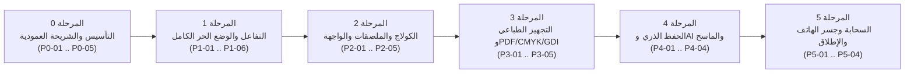

# خطة التطوير الشاملة وخارطة التنفيذ — Ziwa Studio Master Development Plan

> **البوصلة العليا للمنتج:** «سهل ممتنع — دقة مطبعية احترافية بسرعة واستجابة تطبيق مكتبي أصيل».
> **المرجع المعماري الحاكم:** [`docs/ARCHITECTURE.md`](ARCHITECTURE.md) · **الثوابت الموروثة:** [`docs/GRIDO_LESSONS_AND_INVARIANTS.md`](GRIDO_LESSONS_AND_INVARIANTS.md)

---

## 1. مؤشر الاستئناف الحي (Live Session Pointer)

> **إلزامي لكل وكيل أو مطور عند بدء أي جلسة تطويرية:**
> اقرأ هذا الجدول أولاً، والتزم بالمهمة النشطة وحدودها المعمارية، ولا تقفز إلى مرحلة لاحقة قبل استيفاء جميع معايير القبول للمرحلة الجارية وتحديث هذا المؤشر بالأدلة الفعلية.

| المؤشر | القيمة الحالية |
| --- | --- |
| **المرحلة الحالية** | **المرحلة 4 — التخزين الذري، الذكاء الاصطناعي الهجين، والماسح الضوئي (`Persistence, AI & Scanner`)** |
| **آخر إنجاز مكتمل** | إغلاق `P4-01`: حزم `.ziwa` إصدارية بالأصول الأصلية وبصمات `SHA-256`، الحفظ الذري المتدفق، مكتبة `SQLite WAL` ونسخ `.ziwabackup` الآمنة، `CrashGuard` بلقطات تعافٍ مستقلة، وأوامر الفتح/الحفظ وحماية العمل غير المحفوظ وربط المكتبة والتعافي بالواجهة |
| **المهمة التالية المباشرة** | **`P4-02` — الذكاء الاصطناعي المحلي الأوفلاين: عزل الخلفية، تعديل القناع، وتأطير الوجه** |
| **جاهزية البيئة المحلية** | ✅ **مكتملة:** `.NET 10 SDK` (`10.0.404` في `C:\Program Files\dotnet\sdk`) + `Node.js` لبوابة التوثيق |
| **بوابات التحقق الفعّالة حالياً** | `dotnet format Ziwa.sln --verify-no-changes` · `dotnet build Ziwa.sln -c Release` · `dotnet test Ziwa.sln -c Release` · `node scripts/docs-gate.mjs --strict-refs` |

---

## 2. خارطة المسار العام للمشروع (6 مراحل متكاملة)

| المرحلة | الهدف الاستراتيجي | عدد المهام | المخرج القابل للتجربة بنهاية المرحلة |
|---|---|---|---|
| **المرحلة 0** | إثبات صحة المحرك (`Avalonia + SkiaSharp + HarfBuzz`) والتطابق `300 DPI` | `5` مهام | نافذة RTL بتصميم Fluent 2 تعرض ورقة حية مع نص عربي وصورة وتصدّر `300 DPI` مطابقاً للبكسلات |
| **المرحلة 1** | بناء محرر الوضع الحر الكامل مع الأوامر و`Undo/Redo` والأقنعة والنصوص المنحنية | `6` مهام | محرر تصميم حر متكامل بسلاسة `60fps` وقص موضعي غير هدّام وتلوين SVG |
| **المرحلة 2** | بناء محرك الكولاج الفيزيائي واستوديو الملصقات البارامتري والمفتش السياقي | `5` مهام | استوديو صور هوية وكولاج وبطاقات وأختام بارامترية جاهز للتصميم السريع |
| **المرحلة 3** | إغلاق منظومة ما قبل الطباعة (`Bleed`, `CutContour`, `Vector PDF`, `CMYK TIFF`, `Win32 GDI`) | `5` مهام | مخرجات مطبعية احترافية حقيقية وطباعة مباشرة مضبوطة بالمليمتر على ويندوز |
| **المرحلة 4** | الحفظ الموثوق (`.ziwa` + `SQLite` + `CrashGuard`) والذكاء الاصطناعي الهجين والماسح | `4` مهام | عزل خلفية أوفلاين، ماسح مستندات ذكي، وترميم وجوه سحابي آمن مع حفظ لا يضيع |
| **المرحلة 5** | الحسابات والتراخيص، جسر الهاتف، المحدّث الآمن، أنابيب `CI`، وحزمة التثبيت `v1.0.0` | `4` مهام | منتج مكتمل جاهز للنشر والتثبيت والتحديث مع بوابات جودة سحابية شاملة |

---

## 3. الخطة التنفيذية التفصيلية للمراحل والمهام (`29` مهمة هندسية)

### المرحلة 0: التأسيس البنيوي والشريحة العمودية الحاسمة (`Foundation & Vertical Slice`)
> **فلسفة المرحلة:** لا نبني عشرات الشاشات قبل أن نثبت بالبرهان الآلي أن الكانفاس يرسم العربية والصور بسلاسة `60fps` ويصدّر `300 DPI` مطابقاً للشاشة 100%.

#### `P0-01` — تأسيس الحل `Ziwa.sln` وإدارة الحزم المركزية وعزل الطبقات
- **النطاق والمخرجات:**
  - إنشاء `Directory.Build.props` (`net10.0`, `LangVersion=14`, `Nullable=enable`, `ImplicitUsings=enable`, `TreatWarningsAsErrors=true`) و`Directory.Packages.props` (CPM).
  - إنشاء المشاريع الـ 6 في `src/` (`Ziwa.Domain`, `Ziwa.Rendering`, `Ziwa.Application`, `Ziwa.Infrastructure`, `Ziwa.Platform.Windows` المستهدف لـ `net10.0-windows`, و`Ziwa.App`) والمشاريع الـ 5 في `tests/`.
  - إعداد حاوية حقن الاعتماديات `ServiceCollection` في `Ziwa.App` مع تسجيل شرطي لخدمات `Ziwa.Platform.Windows` واختبار معماري آلي يتحقق من عدم وجود مراجع عكسية ممنوعة.
- **معيار القبول:** نجاح `dotnet restore` و`dotnet build -c Release` بصفر تحذيرات، واجتياز اختبار فحص حدود الطبقات في `Ziwa.Domain.Tests` · الحالة: `✅ done`

#### `P0-02` — نواة `Ziwa.Domain`: الرياضيات المليمترية ونموذج المستند غير المتغير
- **النطاق والمخرجات:**
  - تنفيذ `DomainMath` (`MmPerInch = 25.4`, تحويلات `Mm <-> Px <-> Pt`, ومقاسات الورق القياسية `A4, A5, 4x6 in, ID Card CR80` وغيرها).
  - بناء السجلات غير المتغيرة `ZiwaDocument`, `PageModel`, `BackgroundSpec`, والعقد الأولية (`ImageNode`, `ShapeNode`, `TextNode`) و`SchemaValidator` لفحص الأرقام المنتهية والموجبة.
- **معيار القبول:** اختبارات وحدة شاملة في `Ziwa.Domain.Tests` تغطي دقة التحويلات، ثبات `Immutable Records` مع `with`، ورفض قيم `NaN / Infinity / <= 0` · الحالة: `✅ done`

#### `P0-03` — نظام تصميم `Fluent 2 RTL` والهيكل الرئيسي للنافذة (`Ziwa.App`)
- **النطاق والمخرجات:**
  - بناء `Themes/Tokens.axaml` شاملاً قواميس الثيم الداكن والفاتح، الأسطح، الحدود الشعرية، ألوان الإجراءات المتوافقة مع التباين `>= 4.5:1`، وسلم الاستدارة (`4px / 6px / 10px`).
  - تضمين الخطوط العربية الأوفلاين الأساسية (`Cairo`, `Tajawal`, `IBM Plex Sans Arabic`) وتهيئة `MainWindow.axaml` بـ `FlowDirection="RightToLeft"` و`CompiledBindings`، مع هيكل المناطق الخمس (الشريط العلوي، سكة الأدوات، منطقة الكانفاس، المفتش، شريط الحالة).
- **معيار القبول:** إقلاع النافذة بسلاسة، تبديل الثيم الفاتح/الداكن لحظياً دون ألوان Hex خام، واجتياز اختبار `Avalonia.Headless.XUnit` لاتجاه `RTL` والربط المصرّف · الحالة: `✅ done`

#### `P0-04` — نواة `Ziwa.Rendering` ومضيف GPU التفاعلي (`SkiaViewportHost`)
- **النطاق والمخرجات:**
  - بناء `AssetStore` الأولي + `DisplayProxyCache` (`<= 2048px` مع `SKCodec` وتطبيع دوران `EXIF`).
  - بناء `FontRegistry` و`HarfBuzzArabicShaper` لرسم النصوص العربية المتصلة والمشكّلة والمختلطة `BiDi`.
  - بناء `SceneRenderer.RenderPage` الأولي (ورقة + ظل + مستطيل + صورة + نص عربي) وربطه داخل `SkiaViewportHost` عبر `ICustomDrawOperation` و`ISkiaSharpApiLeaseFeature` مع دعم التكبير حول مؤشر الماوس (`Zoom-to-Cursor`) والتحريك (`Pan`).
- **معيار القبول:** عرض صفحة تجريبية تحوي صورة ونصاً عربياً مشكّلاً وأشكالاً مع تحريك وتكبير ناعم، والتأكد من عدم تسرب كائنات `SKPaint / SKImage` · الحالة: `✅ done`

#### `P0-05` — إغلاق الشريحة العمودية: التصدير النقطي `300 DPI` وحقن ترويسات الكثافة الفيزيائية
- **النطاق والمخرجات:**
  - بناء `PngJpegExporter` فوق نفس `SceneRenderer` بدقة قابلة للتخصيص (`300 / 600 DPI`).
  - كتابة حاقن الكثافة المادية الموحد لكتلة `pHYs` في PNG وترويسة `JFIF` في JPEG حتى تقرأ برامج الطباعة المقاس المليمتري الحقيقي.
  - إعداد `Verify.Xunit` في `Ziwa.Rendering.Tests` لاختبار التطابق البصري وفحص البايتات للـ DPI.
- **معيار القبول:** تطابق بصري موثّق بين رسم العرض ورسم `300 DPI`، والتحقق برمجياً من أن ملفات PNG/JPEG الناتجة تحمل كثافة `300 DPI` وأبعاد البكسل الصحيحة لورقة المليمتر · الحالة: `✅ done`

---

### المرحلة 1: محرك التفاعل والأوامر والوضع الحر الكامل (`Freeform Canvas & Interaction Engine`)

#### `P1-01` — جلسة المستند، الحالة ثنائية الطور، وسجل `Undo/Redo` و`CommandRegistry`
- **النطاق والمخرجات:**
  - بناء `DocumentSession` مع الفصل بين `CommittedDocument` و`InteractionPreview` (لضمان سحب منزلقات وعناصر بسرعة `60fps` دون تلويث `UndoStack` إلا عند الإفلات، وإلغاء نظيف بـ `Esc`).
  - بناء `UndoRedoStack` مع دمج الحركات المتقاربة (`Nudge Coalescing`) وبناء `CommandRegistry` الموحد للاختصارات والقوائم.
- **معيار القبول:** اختبارات `Ziwa.Application.Tests` تثبت أن 50 حركة سحب متصلة تنتج خطوة `Ctrl+Z` واحدة، وأن `Esc` يلغي السحب دون أثر في التاريخ · الحالة: `✅ done`

#### `P1-02` — أدوات التحديد، مقابض التحويل، التحديد المتعدد، والتجميع (`Group/Ungroup`)
- **النطاق والمخرجات:**
  - بناء نظام `HitTesting` الهندسي الدقيق (يدعم العناصر المدارة والمجموعات والعناصر المقفلة/المخفية).
  - رسم وتفاعل مقابض التحجيم الثمانية + مقبض التدوير (مع زوايا التثبيت `15°` عند ضغط `Shift` وقفل النسبة)، وإطار التحديد السحبي (`Marquee Selection`)، وترتيب الطبقات (`BringForward / SendBackward / ToFront / ToBack`)، و`Group / Ungroup`، والنسخ واللصق الداخلي المحمي.
- **معيار القبول:** دقة التحويلات حول المركز المدار، حفظ النسب، وسلامة التراجع بخطوة واحدة للتحديد الفردي والمتعدد والمجموعات · الحالة: `✅ done`

#### `P1-03` — المساطر المثبتة (`20px`)، المحاذاة المغناطيسية الذكية، وأدلة الورقة
- **النطاق والمخرجات:**
  - بناء المسطرتين الأفقية والرأسية (`20px` ثابتة خارج التمرير، متزامنة مع `Zoom/Pan`، تبرز نقطة `(0,0)` وحدود الورقة بالمليمتر وتجنّب تصادم الأرقام عند الأركان).
  - بناء `SnapEngine` للمحاذاة المغناطيسية أثناء السحب والتحجيم (حواف ومركز الورقة، حواف ومراكز العناصر الأخرى، المسافات المتساوية) + رسم أدلة النزيف وهامش الأمان.
- **معيار القبول:** انجذاب سلس ودقيق بالمليمتر مع إمكانية تعطيله مؤقتاً بمفتاح معدل (`Alt`)، واجتياز اختبارات هندسة `SnapEngine` · الحالة: `✅ done`

#### `P1-04` — القص الموضعي غير الهدّام (`In-Place Crop`) والأقنعة الهندسية الثمانية
- **النطاق والمخرجات:**
  - بناء `CropViewportMath` النقية لضبط الكادر داخل الإطار (`CropZoom`, `CropPanX`, `CropPanY`) + واجهة التعديل الموضعي بالنقر المزدوج (`Enter` للاعتماد بخطوة تراجع واحدة، `Esc` للإلغاء، وزر «استعادة الأصل» عبر `OriginalAssetId`).
  - بناء `MaskPathBuilder` الموحد للأقنعة الثمانية (`None`, `Circle`, `Arch`, `Hexagon`, `Diamond`, `Heart`, `Star`, `Seal`) مع احترام الترتيب الصارم: الفلاتر ← القص الهندسي ← الخلفية والحد ← ظل خارجي واحد.
- **معيار القبول:** اختبارات `Verify.Xunit` تثبت تطابق الأقنعة الثمانية والكادر المقصوص عند `300/600 DPI` وعدم انقطاع الظل الخارجي بالقناع · الحالة: `✅ done`

#### `P1-05` — الأشكال الهندسية المتقدمة، إفلات الصور داخل الأشكال، وتلوين شعارات `SVG`
- **النطاق والمخرجات:**
  - استكمال جميع أنواع `ShapeNode` (مستطيل بزوايا موحدة أو مستقلة، دائرة، مضلع، نجمة، خط، سهم، حلقة، قوس، قطاع).
  - تنفيذ الإجراء المزدوج الموروث من `FF-04`: إفلات صورة مباشرة داخل شكل صالح لتحويله لتعبئة صورية (`ImageFill`) تحفظ هندسة الشكل، وأمر «قنّع الصورة بهذا الشكل» عند تحديد صورة وشكل معاً.
  - بناء `SvgSanitizer` (إزالة السكربتات والمراجع الخطرة) واستيراد `SVG` عبر `Svg.Skia` مع ميزة «تلوين الشعار بضغطة واحدة» مع بقاء دقته المتجهة الكاملة.
- **معيار القبول:** تعقيم ملفات SVG الخبيثة في الاختبارات، وبقاء الشعار حاداً عند تكبير `600 DPI`، وعمل إفلات الصور وتقنيع التحديد بخطوة `Undo` واحدة · الحالة: `✅ done`

#### `P1-06` — محرك النصوص المتقدم، الأنماط الجاهزة، والنص العربي المنحني على مسار
- **النطاق والمخرجات:**
  - بناء التحرير النصي الموضعي السلس، وكتالوج الأنماط الطباعية الجاهزة (عنوان، نص فرعي، شارة، ختم، علامة مائية).
  - دعم تأثيرات النصوص (حد خارجي متدرج السُمك، خلفية كبسولة، ظل، تحكم بتباعد الأسطر) وبناء `TextOnCurveRenderer` للنص العربي المنحني للأعلى/الأسفل والدائري الكامل مع بقاء اتصال الأحرف العربية سليماً عبر `HarfBuzz`.
- **معيار القبول:** اختبارات بصرية للنص العربي المنحني والمشكّل تثبت عدم تقطع الحروف المتصلة وعدم قص أقواس المعاينة · الحالة: `✅ done`

---

### المرحلة 2: محرك الكولاج الفيزيائي، استوديو الملصقات، والواجهة السياقية (`Collage, Stickers & Contextual UI`)

#### `P2-01` — محرك شبكات الكولاج الفيزيائي وقوالب صور الهوية
- **النطاق والمخرجات:**
  - نقل وتطوير خوارزميات الحساب الفيزيائي للشبكات بالمليمتر (`PhysicalGridBuilder`: قوالب صور الجوازات والهويات القياسية، الشبكات المتعددة والمختلطة، والشبكة المخصصة بعدد صفوف/أعمدة وفجوات وهوامش ومصفوفة محاذاة `9` نقاط).
  - ضمان قاعدة الأمان الهندسية: عند ضيق الورقة تُصغَّر الخلايا تناسبياً بحيث تبقى كل خلية `>= 1mm` وكامل الشبكة داخل حدود الورقة.
- **معيار القبول:** اختبارات خاصية شاملة (`Property Tests`) تثبت استحالة خروج خلية خارج الورقة أو توليد أبعاد سالبة/`NaN` لأي مدخلات · الحالة: `✅ done`

#### `P2-02` — تفاعل خانات الكولاج، وضع التكرار، والنقل من الوضع الحر
- **النطاق والمخرجات:**
  - دعم تحريك وتكبير وتدوير وقلب الصور داخل الخانات، التبديل بالسحب بين خليتين (`Swap`)، وضع «التعبئة التلقائية / تكرار صورة الهوية على كامل الشيت»، وشريط انتظار الصور غير الموزعة.
  - بناء أداة «نقل التصميم الحر إلى الكولاج» التي تلتقط تصميم الوضع الحر بدقة الطباعة وتوزعه في خانات الكولاج دون تغيير مقاس ورقة الكولاج أو قالبها.
- **معيار القبول:** ثبات قالب الكولاج ومقاسه عند النقل، وعمل التوزيع والتفريغ والتبديل بخطوة تراجع واحدة · الحالة: `✅ done`

#### `P2-03` — خط أنابيب مرشحات الصور الموحد (`Color & Pixel Filters`)
- **النطاق والمخرجات:**
  - بناء المرشحات عبر `SKColorFilter` ومعالجات البكسل المشتركة (`Brightness`, `Contrast`, `Saturation`, `Blur`, `LuminanceThreshold`, `NearestNeighborPixelate`, والمرشحات الفوتوغرافية الجاهزة + زر «تطبيق على كل الخانات» و«إعادة تعيين»).
- **معيار القبول:** تطابق رقمي وبصري بين الفلتر المعروض على الشاشة والفلتر المصدّر في PNG وPDF وCMYK · الحالة: `✅ done`

#### `P2-04` — استوديو الملصقات والبطاقات والأختام البارامتري (`Parametric Sticker Studio`)
- **النطاق والمخرجات:**
  - بناء محرك القوالب البارامترية المتجهة (أختام تجارية، شارات ضمان/خصم، بطاقات أعمال وعروض) مع منشئات حقول موحدة واشتقاق لوحات لونية متناغمة في فضاء `OKLCH` تضمن تباين النصوص تلقائياً، وزر «توليفة عشوائية ذكية».
  - دعم إعادة التحرير غير الهدّامة: النقر المزدوج على أي ملصق مدرج يفتح استوديو الملصقات بقيمه الحالية لتعديله في مكانه دون فقدان موضعه أو حجمه.
- **معيار القبول:** سلامة توليد جميع القوالب البارامترية بلا أخطاء XML/SVG، وعمل إعادة التحرير بالنقر المزدوج ذهاباً وإياباً مع `Ctrl+Z` · الحالة: `✅ done`

#### `P2-05` — المفتش السياقي، الشريط السريع `QuickBar`، لوحة `Ctrl+K`، وشاشة البداية الذكية
- **النطاق والمخرجات:**
  - صقل `InspectorPanel` السياقي (يفتح تلقائياً عند التحديد ويعود لحالته عند الإلغاء، ويُبرز إجراءات الملصق قبل أدوات الـ AI عند تحديد ملصق)، وبناء `QuickBar` العائم لأهم إجراءات اللحظة، ولوحة البحث الفوري عن الأوامر `Ctrl+K`، ووضع `Zen Mode` (`Ctrl+.`).
  - بناء تجربة الانطلاق السريعة (بدء سريع: شيت صور هوية، بطاقة عمل وجه/ظهر، شيت ملصقات، ورقة حرة) + ركن «أصولي / هويتي» المحلي لإدراج شعار الاستوديو وألوانه وعباراته بضغطة واحدة.
- **معيار القبول:** اجتياز اختبارات `Avalonia.Headless.XUnit` لدورة حياة الألواح والاختصارات والوصولية (`AutomationProperties.Name`) · الحالة: `✅ done`

---

### المرحلة 3: التجهيز الطباعي الاحترافي والطباعة المباشرة (`Pre-Press, Export & Direct Printing`)

#### `P3-01` — تعدد الصفحات المبسّط (وجه + ظهر وصفحات متسلسلة)
- **النطاق والمخرجات:**
  - تفعيل شريط الصفحات السفلي الخفيف (إضافة صفحة، تكرار صفحة، تبديل سريع بين الوجه والظهر، إعادة ترتيب، وحذف محمي) مع مشاركة مقاس الورقة والنزيف افتراضياً ودعم التصدير/الطباعة لصفحة محددة أو لكل الصفحات.
- **معيار القبول:** إنشاء بطاقة وجه وظهر والتنقل بينهما وتصديرهما بانتظام مع بقاء واجهة الصفحة الواحدة نظيفة وبسيطة · الحالة: `✅ done`

#### `P3-02` — النزيف (`Bleed`)، علامات القص، ومسار البلوتر `Sheet CutContour` وفحص ما قبل الطباعة
- **النطاق والمخرجات:**
  - توليد منطقة النزيف وعلامات القص المليمترية في الأركان وعلامات التسجيل البصرية للبلوتر (`Registration Marks`)، وتجميع مسارات القطع الخارجية للعناصر والملصقات في مسار متجه موحد `CutContour`.
  - بناء فاحص ما قبل الطباعة الهادئ (`Preflight Checker`): ينبّه لدقة الصور شديدة الانخفاض بالنسبة لمقاس الطباعة الفعلي (`Effective DPI < 150`) أو النصوص القريبة بشكل خطر من خط القص مع إمكانية تحديد العنصر بضغطة دون تحريك قسري للتصميم.
- **معيار القبول:** دقة إحداثيات `CutContour` وعلامات القص بالمليمتر، وعدم إطلاق إنذارات خاطئة على الخلفيات الممتدة عمداً للنزيف · الحالة: `✅ done`

#### `P3-03` — مُصدِّر `Vector PDF` الاحترافي والتصدير المجزّأ للأوراق العملاقة (`Tiled Export`)
- **النطاق والمخرجات:**
  - بناء `VectorPdfExporter` عبر `SKDocument.CreatePdf` مع دعم الصفحات المتعددة، بقاء النصوص والأشكال والشعارات و`CutContour` متجهة بالكامل، وتضمين الصور المقصوصة بدقة الطباعة.
  - تنفيذ آلية `Tiled Render` التلقائية في التصدير النقطي للمقاسات الضخمة (بانرات/بوسترات كبيرة) لمنع تجاوز سقف الذاكرة.
- **معيار القبول:** فتح ملف الـ PDF الناتج والتحقق آلياً من وجود أوامر مسارات متجهة وحجم ملف متوازن، ونجاح تصدير لوحة عملاقة ضمن ميزانية ذاكرة منضبطة · الحالة: `✅ done`

#### `P3-04` — مُصدِّر `CMYK TIFF` المطابِق للمطابع مع ملفات تعريف الألوان (`ICC Profiles`)
- **النطاق والمخرجات:**
  - بناء `CmykTiffExporter` باستخدام `Magick.NET` لتحويل مخرج `SceneRenderer` إلى فضاء `CMYK` الحقيقي باستخدام ملفات `ICC` قياسية مضمّنة (مثل `Coated FOGRA39` أو ملف مخصص يختاره المستخدم)، وضغط `LZW` غير فاقد، وحقن كثافة الـ DPI الفيزيائية، والتحقق من سلامة ترويسة الملف قبل الاعتماد الذري.
- **معيار القبول:** اختبار آلي يفحص الملف الناتج ويثبت أن `ColorSpace == CMYK` والكثافة المادية سليمة والحفظ قابل للإلغاء الفوري عبر `CancellationToken` · الحالة: `✅ done`

#### `P3-05` — محرك الطباعة المباشرة على ويندوز (`Direct Win32 GDI Print Spooler`) وحوار الطباعة
- **النطاق والمخرجات:**
  - تنفيذ `GdiPrintSpooler` في `Ziwa.Platform.Windows` مع تعداد الطابعات المثبتة، قراءة المقاسات وهوامش العتاد الحقيقية (`GetDeviceCaps`)، دعم الاتجاه والنسخ والطباعة القياسية أو بلا حواف (`Borderless`), ومعادلة المعايرة المليمترية الدقيقة، وإمكانية إلغاء المهمة في الطابور (`CancelSpoolJob`).
  - تصميم نافذة إعدادات الطباعة المدمجة بمعاينة حية لتموضع التصميم والهوامش وخطوط القص على الورقة الفعلية للطابعة المختارة.
- **معيار القبول:** تغليف كامل مقابض Win32 بـ `SafeHandle`، تطابق أبعاد خطة الطباعة المحسوبة بالمليمتر مع مقاييس الجهاز الوهمي/الفعلي في الاختبارات، وعدم تجاهل أي خطأ من الـ Spooler · الحالة: `✅ done`

---

### المرحلة 4: التخزين الذري، الذكاء الاصطناعي الهجين، والماسح الضوئي (`Persistence, AI & Scanner`)

#### `P4-01` — ملفات المشاريع `.ziwa`، قاعدة `SQLite WAL`، وحارس التعافي `CrashGuard`
- **النطاق والمخرجات:**
  - تنفيذ `AtomicFileWriter` (`*.tmp` + `Flush(flushToDisk: true)` + `File.Move overwrite` + تنظيف `finally`) ومنع أي كتابة مباشرة غير ذرية.
  - بناء حزمة المشروع `.ziwa` (معنونة بالبصمة `SHA-256` لمنع تكرار الصور + `SchemaVersion` مع خط أنابيب ترحيل `IDocumentMigrator`)، ومكتبة المشاريع في `SQLite WAL` مع استيراد/تصدير النسخ الاحتياطية، و`CrashGuard` للاسترداد التلقائي بعد الإغلاق غير الطبيعي.
- **معيار القبول:** اختبارات محاكاة الفشل في `Ziwa.Infrastructure.Tests` تثبت عدم تلف المشروع الأصلي عند فشل الحفظ في المنتصف، واستعادة لقطة التعافي بدقة 100% · الحالة: `✅ done`

#### `P4-02` — الذكاء الاصطناعي المحلي الأوفلاين: عزل الخلفية، تعديل القناع، وتأطير الوجه
- **النطاق والمخرجات:**
  - دمج `Microsoft.ML.OnnxRuntime` في خيط خلفي قابل للإلغاء لعزل الخلفية أوفلاين (بما في ذلك تفاصيل الشعر) مع نافذة التعديل اليدوي للقناع بفرشاة المسح/الاستعادة ومعاينة قبل/بعد.
  - بناء أداة «تأطير الوجه التلقائي لصور الهوية» التي تكتشف الوجه وتضبط `CropZoom / CropPan` لتوسيط الرأس بالنسب القياسية لصور المعاملات الرسمية بضغطة واحدة.
- **معيار القبول:** بقاء الواجهة متجاوبة `100%` أثناء الاستدلال، إلغاء فوري بـ `CancellationToken`، وحفظ الأصل دائماً للاستعادة · الحالة: `⬜ pending`

#### `P4-03` — ماسح المستندات والبطاقات الذكي واستعدال المنظور (`OpenCvSharp4`)
- **النطاق والمخرجات:**
  - بناء نافذة الماسح الضوئي المتكاملة: الكشف التلقائي لحواف مستند واحد أو عدة بطاقات على نفس الصورة، تعديل الزوايا الأربع بالعدسة المكبّرة، أداة تقسيم بطاقات الهوية، استعدال المنظور (`Perspective Warp`)، والفلاتر الخمسة للمستندات (اللون السحري، `Otsu` أبيض وأسود، رمادي محسن، إزالة الاصفرار، والحدة).
- **معيار القبول:** قفل نظيف لأدوات التعديل أثناء المعالجة، تطابق نتائج الفلاتر، وإدراج المستندات المستخرجة في الوضع الحر أو خانات الكولاج بخطوة تراجع واحدة · الحالة: `⬜ pending`

#### `P4-04` — عميل الترميم السحابي المزدوج (`Modal CPU`: Real-ESRGAN 2x + CodeFormer)
- **النطاق والمخرجات:**
  - بناء `ModalAiUpscaler` المتوافق مع الخادم السحابي القائم: تحقق محلي من سقف الأبعاد (`<= 2048px`)، إرسال `Authorization: Bearer <UserJWT>` و`Idempotency-Key` (`UUIDv4`)، مهلة عميل `180s` بلا إعادة محاولة تلقائية، وحارس `OperationCoordinator` لمنع تطبيق نتيجة قديمة.
  - تحديث الصورة في الكانفاس أو خانة الكولاج بدقتها المضاعفة `2x` مع معايرة إزاحات الخانة تلقائياً ليبقى الكادر متطابقاً.
- **معيار القبول:** اختبارات خادم وهمي تغطي النجاح، الإلغاء، المهلة، خطأ `409` المكرر، ورفض الحقن عند تبديل المستند قبل عودة الرد · الحالة: `⬜ pending`

---

### المرحلة 5: السحابة والتراخيص، جسر الهاتف، التحزيم، والإطلاق (`Cloud, Bridge, CI & Release`)

#### `P5-01` — المصادقة والتراخيص وحصص الاستخدام (`Supabase Auth & Licensing`)
- **النطاق والمخرجات:**
  - بناء `SupabaseAuthClient` ونافذة الحساب والتراخيص (تسجيل/دخول بالبريد، تحقق `OTP`، استعادة كلمة المرور، تسجيل دخول `Google OAuth` عبر خادم استرجاع محلي مؤقت آمن الـ `state`، وتفعيل مفتاح الترخيص).
  - تطبيق عقد الجلسة الواحدة النشطة (`Last-Wins`)، عرض شارة الحصة اليومية الموثقة خادمياً وتصفيرها عند الخروج، والتعامل الصادق مع الانقطاع المؤقت للشبكة دون طرد المستخدم خطأً.
- **معيار القبول:** اختبارات شاملة لسباقات تجديد التوكن (`Refresh Token Race`)، عدم إحياء جلسة بعد تسجيل الخروج، وعدم تسجيل أي توكن في ملفات السجل · الحالة: `⬜ pending`

#### `P5-02` — جسر الهاتف الفوري (`Phone Bridge` عبر الشبكة المحلية / السحابة)
- **النطاق والمخرجات:**
  - بناء خادم الجسر المدمج وواجهة الاقتران برمز `QR Code` مع صفحة الرفع الخفيفة للهاتف (`/cam` بكاميرا خلفية افتراضية)، وتطبيق رمز الجلسة العشوائي وسقف الحجم `413` وفحص التوقيع السحري للصور وإشعار وصول الصور الفوري داخل المحرر.
- **معيار القبول:** رفض أي طلب بدون رمز صالح أو بحجم متجاوز أو بملف غير صوري في اختبارات التكامل · الحالة: `⬜ pending`

#### `P5-03` — إطار النافذة المدمج، المثيل الواحد، السجلات المهيكلة، والمحدّث الآمن
- **النطاق والمخرجات:**
  - تخصيص شريط عنوان النافذة المدمج (`Frameless / ExtendClientArea`) مع احترام أزرار النظام وتكبير الشاشة، وتفعيل حارس المثيل الواحد (`Single-Instance`) الذي يوقظ النافذة المفتوحة ويمرر إليها مسار ملف `.ziwa` المنقور عليه في ويندوز، ودعم إفلات الصور الأصلي من Explorer (`Native OLE Drop` مع تصفية غير الصور).
  - إعداد `Serilog` بملفات دوّارة وميزة «تصدير سجلات الدعم الفني» المنقّاة من أي بيانات حساسة، وبناء المحدّث التلقائي بتحقق `HTTPS + SHA-256 Fail-Closed`.
- **معيار القبول:** رفض أي حزمة تحديث تفتقر لبصمة `SHA-256` صحيحة، وعمل اقتران امتداد `.ziwa` والمثيل الواحد بنجاح · الحالة: `⬜ pending`

#### `P5-04` — أنابيب `GitHub Actions CI`، حزمة التثبيت الرسمية، وجولة القبول النهائية `v1.0.0`
- **النطاق والمخرجات:**
  - بناء `.github/workflows/ci.yml` و`release.yml`: فحص `docs-gate --strict-refs`، فحص `dotnet format --verify-no-changes`، البناء الصارم، تشغيل اختبارات الوحدة والتطابق البصري و`Avalonia.Headless` على Linux وWindows.
  - إعداد حزمة التثبيت لنظام ويندوز (`Velopack` أو `InnoSetup`) مع الحفاظ التام على مشاريع وبيانات المستخدم عند الترقية أو إلغاء التثبيت، وتوليد `ziwa-checksums.txt` تلقائياً.
- **معيار القبول:** اخضرار كامل لأنبوب `CI` السحابي، وتثبيت وترقية النسخة التجريبية على بيئة نظيفة بنجاح كامل · الحالة: `⬜ pending`

---

## 4. سجل المخاطر الهندسية والضوابط الاستباقية (Risk Register)

| الخطر المحتمل | أثره إن أُهمل | الضابط المعماري المعتمد في Ziwa |
|---|---|---|
| **بطء الواجهة عند سحب العناصر أو المنزلقات** | تقطّع الإطارات وتضخم سجل التراجع | فصل الحالة ثنائي الطور (`InteractionPreview` الحي مقابل `CommittedDocument` عند الإفلات فقط) + `CompiledBindings` |
| **انفصال الحروف العربية على المسارات المنحنية أو في الـ PDF** | تشوّه الأختام والبطاقات العربية عند الطباعة | التشكيل المسبق عبر `HarfBuzzSharp` وتحويل العناقيد المتصلة لمسارات دقيقة على `SKPathMeasure` |
| **نفاد الذاكرة (`OOM`) عند تصدير لوحات كبيرة بـ `600 DPI` أو `CMYK`** | انهيار التطبيق أثناء الحفظ | كاش معاينة مصغّر (`<= 2048px`) للمحرر + التصدير المجزّأ بالبلاطات (`Tiled Render`) للمقاسات الكبيرة |
| **اختلاف المقاس المطبوع على الورق عن المقاس المصمَّم** | رفض صور الهوية أو فساد قص الاستوديو | المليمتر وحدة الحقيقة الوحيدة (`25.4`) + معايرة `GetDeviceCaps` الفعلية في `Win32 GDI` + حقن `pHYs`/`JFIF` |
| **تلف ملف المشروع عند انقطاع الكهرباء أو الإغلاق المفاجئ** | ضياع عمل العميل | `AtomicFileWriter` (`Flush(flushToDisk: true)` قبل الاستبدال الذري) + حارس التعافي `CrashGuard` |
| **تضخم التوثيق وتشتت الوكلاء الأذكياء مع كبر المشروع** | بطء الجلسات وهلوسة الوكلاء | التزام صارم بـ `5` قواعد و`5` مهارات مركّزة ونظام `Fragment-First` محروس بـ `scripts/docs-gate.mjs` |

---

## 5. قواعد إغلاق المهام وتسليم الجلسات (Definition of Done & Handoff Protocol)

لا تتحول حالة أي مهمة أعلاه من `⬜ pending` أو `🔄 in_progress` إلى `✅ done` إلا بعد استيفاء الشروط الخمسة مجتمعة:
1. **نظافة معمارية بلا ديون:** احترام حدود المشاريع الستة، صفر ألوان خام في `.axaml`، وصفر كود مكرر أو ميت (`Zero Importers`).
2. **بناء وتنسيق نظيف 100%:** نجاح `dotnet build Ziwa.sln` بصفر تحذيرات (`TreatWarningsAsErrors`) ونجاح `dotnet format Ziwa.sln --verify-no-changes`.
3. **إثبات آلي بالاختبارات:** إضافة واجتياز اختبارات حقيقية تغطي المهمة (وحدة في `Domain/Application`، تطابق بصري `Verify.Xunit` في `Rendering`، أو `Avalonia.Headless` في `App`).
4. **توثيق رشيق صادق:** إنشاء `fragment` واحد في `changelog/fragments/`، تحديث حالة المهمة و«مؤشر الاستئناف الحي» وسطر جديد في «سجل تسليم الجلسات» أدناه، واجتياز `node scripts/docs-gate.mjs --strict-refs`.
5. **اعتماد سحابي (عند التهيئة لـ Git/CI):** تسجيل `Commit SHA` ونتيجة `CI` الفعلية دون تخمين.

---

## 6. سجل تسليم الجلسات (Session Handoff Log)

| التاريخ | المهمة | الملخص وأدلة التحقق | الالتزام (`Commit SHA`) |
| --- | --- | --- | --- |
| `2026-11-25` | **التأسيس المعماري الشامل** | تأسيس مجلد `Ziwa`، تثبيت `.NET 10 SDK (10.0.404)`، كتابة المعمارية الهندسية الكاملة (`ARCHITECTURE.md`) وخطة التطوير الشاملة من 6 مراحل و29 مهمة (`DEVELOPMENT_PLAN.md`) والمواصفات المكملة ومنظومة `.agents/` الرشيقة، واجتياز `node scripts/docs-gate.mjs --strict-refs`. | `تأسيس محلي أولي` |
| `2026-11-25` | **إنجاز المرحلة 0 (`P0-01 .. P0-05`)** | إنشاء `Ziwa.sln` بـ 11 مشروعاً مع CPM وعزل الطبقات، نواة `Ziwa.Domain`، واجهة `Fluent 2 RTL` مع `Tokens.axaml` والخطوط العربية المضمّنة، محرك `SceneRenderer` + `HarfBuzzArabicShaper` + `SkiaViewportHost`، ومُصدِّر `PNG/JPEG 300/600 DPI` وحفظ ذري. تم اجتياز `dotnet format --verify-no-changes` وبناء `Release` بصفر تحذيرات واختبارات جميع المشاريع الخمسة (`Domain` 21، `Rendering` 8 مع `Verify.Xunit`، `Application` 3، `Infrastructure` 2، `App.Tests` 4) و`docs-gate --strict-refs`. | `تطوير محلي (بدون Git بعد)` |
| `2026-11-25` | **إنجاز المرحلة 1 (`P1-01 .. P1-06`)** | بناء `DocumentSession` ثنائية الطور و`UndoRedoStack` (`Nudge Coalescing`) و`CommandRegistry` الموحد، محرك `HitTestEngine` ومقابض التحويل والتجميع واللصق المحمي، المساطر `20px` (`CanvasRulerControl`) و`SnapEngine`، الأقنعة الثمانية (`MaskPathBuilder`) والقص الموضعي غير الهدّام، الأشكال العشرة وتعقيم/تلوين `SvgNode` عبر `Svg.Skia`، والنص العربي المنحني `TextOnCurveRenderer`. تم اجتياز `dotnet format --verify-no-changes`، بناء `Release` بصفر تحذيرات، الاختبارات الخمسة (`Domain` 22، `Rendering` 12 مع `Verify.Xunit`، `Application` 14، `Infrastructure` 2، `App.Tests` 4)، و`docs-gate --strict-refs`. | `تطوير محلي (بدون Git بعد)` |
| `2026-11-25` | **إنجاز المرحلة 2 (`P2-01 .. P2-05`)** | بناء محرك شبكات الكولاج الفيزيائي `PhysicalGridBuilder` وقوالب الهوية، تبديل/تكرار الخانات ونقل الوضع الحر للكولاج (`FreeformToCollageService`)، خط المرشحات الموحد `ImageFilterPipeline`، استوديو الملصقات البارامتري + `OklchPaletteGenerator` وإعادة التحرير غير الهدّامة، والمفتش السياقي التلقائي + `QuickBar` + `Ctrl+K` + `Zen Mode` (`Ctrl+.`) + البداية السريعة وركن «هويتي». تم اجتياز `dotnet format --verify-no-changes`، بناء `Release` بصفر تحذيرات، `67` اختباراً عبر المشاريع الخمسة (`Domain` 26 مع 280 فحص خاصية، `Rendering` 14 مع `Verify.Xunit`، `Application` 17، `Infrastructure` 3، `App.Tests` 7)، و`docs-gate --strict-refs`. | `تطوير محلي (بدون Git بعد)` |
| `2026-11-25` | **إنجاز المرحلة 3 (`P3-01 .. P3-05`)** | تفعيل تعدد الصفحات المبسّط (`MultiPageOperations` وشريط الصفحات السفلي)، علامات القص والتسجيل ومسار البلوتر `CutContour` (`PrintMarksAndCutContourRenderer`) وفاحص ما قبل الطباعة الهادئ (`PreflightChecker`)، مُصدِّر `Vector PDF` متعدد الصفحات (`VectorPdfExporter`) والتصدير المجزّأ بالبلاطات (`TiledRasterRenderer` للوحات `> 6000px`)، مُصدِّر `CMYK TIFF` (`CmykTiffExporter` مع `ICC` وضغط `LZW` وإلغاء فوري)، ومحرك الطباعة المباشرة على ويندوز (`GdiPrintSpooler` + `SafeHandle` + `PrintCalibrationPlanner` وحوار الطباعة). تم اجتياز `dotnet format --verify-no-changes`، بناء `Release` بصفر تحذيرات، `80` اختباراً عبر المشاريع الخمسة (`Domain` 26، `Rendering` 18، `Application` 21، `Infrastructure` 4، `App.Tests` 11)، و`docs-gate --strict-refs`. | `تطوير محلي (بدون Git بعد)` |
| `2026-11-25` | **إنجاز `P4-01` — المشاريع والمكتبة والتعافي** | تنفيذ `ZiwaProjectStore` بحزم `.ziwa` إصدارية وبصمات SHA-256 للأصول الأصلية، `ProjectDocumentSerializer` وترحيلات متتابعة وفحص الحزم، `AtomicFileWriter` المتدفق، `SqliteProjectRepo` مع WAL وترحيلات مرقمة ونسخ `.ziwabackup` لا تستبدل المشاريع، و`CrashGuard` بقفل لكل تشغيل ولقطات مستقلة وحفظ تلقائي. ربط `ProjectWorkspace` بأوامر الحفظ/الفتح/حفظ باسم والمكتبة، وحماية العمل غير المحفوظ والإغلاق والنتائج المتأخرة. اجتياز `dotnet format --verify-no-changes --no-restore` وبناء Release بصفر أخطاء وتحذيرات و`100` اختبار مستهدف (`Domain` 26، `Application` 30، `Rendering` 11، `Infrastructure` 18، `App.Tests` 15؛ صفر فشل أو تخطٍّ داخل المجموعة المختارة)، و`docs-gate --strict-refs`. البناء النهائي في مجلد `artifacts` مستقل لحماية التطبيق المفتوح؛ الاختبارات ليست تشغيل الحزمة الشاملة. تمت تجربة مكتبية فعلية للحفظ وإعادة الفتح وإلغاء الإغلاق عند وجود تعديلات، ومحاكاة التعافي والفشل آلياً دون قتل نافذة المستخدم. لم تُنفذ ميزات `P4-02` أو نشر أو CI سحابي. | `تطوير محلي — بدون commit/push بهذه الجلسة` |
